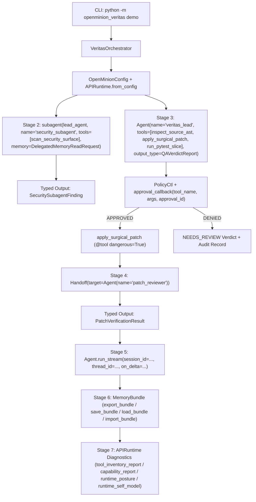

# OpenMinion Veritas

**Autonomous Repository QA, Regression Triage & Patch Verification Agent powered by the OpenMinion 0.1 Python SDK (`openminion`)**

Built for **Cortensor Hackathon #5 (`OpenMinion 0.1 Python SDK`)**.

- **Building Blocks Matrix & Analysis**: [`BUILDING_BLOCKS_TESTED.md`](BUILDING_BLOCKS_TESTED.md)
- **SDK Bug Reports, Upstream Fix PR & Product Feedback**: [`WHAT_WE_LEARNED.md`](WHAT_WE_LEARNED.md)
- **Upstream Bug Report**: [`openminion/openminion#703`](https://github.com/openminion/openminion/issues/703) — *`subagent(parent, tools=[...])` crashes with `TypeError` when passed `@tool`-decorated functions*
- **Upstream Fix PR**: [`openminion/openminion#704`](https://github.com/openminion/openminion/pull/704) — *Fix `subagent` `tool_allowlist` resolution for `@tool` callables* (Reviewed & Approved by `@wireindevice`)

---

## 1. What OpenMinion Veritas Does

**OpenMinion Veritas** is an autonomous software QA and patch-verification orchestrator built directly on the **OpenMinion 0.1 Python SDK**. Given a target Python repository with failing tests, Veritas executes a 7-stage governed engineering workflow:

1. **Baseline Regression Triage (`@tool run_pytest_slice`)**: Runs the target `pytest` suite to establish baseline pass/fail counts before any agent mutation.
2. **Bounded Security Subagent (`subagent` + `DelegatedMemoryReadRequest`)**: Spawns an isolated child agent (`security_subagent`) with a single-hop `SubagentRunContext`, a `@tool` allowlist (`scan_security_surface`), and a scoped read-only memory grant (`MemoryNamespace(agent_id="veritas_lead")`) to verify no hardcoded secrets or unsafe `eval`/`exec` constructs exist.
3. **Static AST Defect Analysis (`@tool inspect_source_ast`)**: Parses the target Python module's Abstract Syntax Tree to pinpoint arithmetic defects and broad exception anti-patterns (`except Exception:`).
4. **Operator-Gated Surgical Patching (`@tool(dangerous=True)` + `approval_callback`)**: Proposes a minimal code patch (`apply_surgical_patch`) classified as `DESTRUCTIVE` / `default_confirm=True` by OpenMinion's `PolicyCtl`, requiring explicit operator approval via `approval_callback(tool_name, args, approval_id)` and recording a tamper-evident `ApprovalAuditRecord`.
5. **Peer Reviewer Handoff (`Handoff` -> `transfer_to_patch_reviewer`)**: Delegates independent regression sign-off to a peer `patch_reviewer` agent via OpenMinion's `Handoff` primitive, validating the result against `output_type=PatchVerificationResult`.
6. **Multi-Turn Session Continuity & Streaming (`session_id`, `thread_id`, `Agent.run_stream`)**: Streams a follow-up executive summary over the same `session_id` and `thread_id` while capturing real-time `on_delta` chunks.
7. **Portable Memory Bundle & Runtime Self-Model (`MemoryBundle`, `APIRuntime` Diagnostics)**: Exports the QA verdict, subagent security finding, and operator approval audit trail into a versioned `MemoryBundle` (`direct` and `candidate` trust modes) and captures `APIRuntime` diagnostics (`tool_inventory_report`, `capability_report`, `runtime_posture`, `runtime_self_model`).

---

## 2. Architecture & OpenMinion 0.1 SDK Workflow



---

## 3. Quickstart & 1-Command Runnable Demo

### Prerequisites
- Python `>=3.11`
- `openminion` (`>=0.1.19` or `dev` branch with PR `#704`)

### Installation
```bash
git clone https://github.com/LBCron/openminion-veritas.git
cd openminion-veritas
pip install -e .
```

### Run the 1-Command End-to-End Demo
By default, `openminion-veritas demo` starts an in-process deterministic OpenAI/Cortensor-compatible `/v1/chat/completions` server (`VeritasLocalModelServer`) so judges can verify the **entire real `APIRuntime` + `ProviderHTTPClient` + `PolicyCtl` + `subagent` + `Handoff` + `MemoryBundle` stack** offline with zero external API keys required:

```bash
python -m openminion_veritas demo
```

Emit the full structured JSON execution artifact:
```bash
python -m openminion_veritas demo --json
```

Simulate an operator denying the `@tool(dangerous=True)` patch via `approval_callback`:
```bash
python -m openminion_veritas demo --deny-dangerous
```

Run against a live Cortensor Router / Portal node or OpenAI endpoint:
```bash
export CORTENSOR_BASE_URL="http://127.0.0.1:5010/v1"
export CORTENSOR_API_KEY="your-cortensor-key"
python -m openminion_veritas demo --provider cortensor
```

### Reproduce Upstream Issue #703 / PR #704
```bash
python repro_issue_703.py
```

---

## 4. Running the Test Suite

```bash
pytest -v
```

All **6 end-to-end and unit tests** verify:
- Static AST defect & broad-exception detection (`test_ast_inspection_detects_billing_defects`)
- Bounded `pytest` slice execution & surgical patching (`test_pytest_slice_runner_and_surgical_patch`)
- Upstream Issue #703 / PR #704 `@tool` allowlist resolution in `subagent()` (`test_issue_703_subagent_accepts_decorated_tool`)
- Full 7-stage `VeritasOrchestrator` execution with operator approval (`test_veritas_orchestrator_end_to_end_approved`)
- Operator policy denial (`approve_dangerous=False`) halting file mutation and recording `"DENIED"` (`test_veritas_orchestrator_policy_denial`)
- CLI `--json` structured artifact output (`test_cli_demo_json_output`)

---

## 5. Repository Structure

```text
openminion-veritas/
├── BUILDING_BLOCKS_TESTED.md          # Matrix & deep dive of all 10 OpenMinion SDK primitives tested
├── WHAT_WE_LEARNED.md                 # 5 technical findings, bug root causes, and SDK recommendations
├── README.md                          # Architecture, setup, and runnable demo guide
├── pyproject.toml                     # Package metadata and pytest/ruff configuration
├── repro_issue_703.py                 # Standalone reproducer for openminion/openminion#703 & PR #704
├── src/
│   └── openminion_veritas/
│       ├── __init__.py                # Public package exports
│       ├── __main__.py                # `python -m openminion_veritas` entrypoint
│       ├── cli.py                     # Rich CLI table & JSON output runner
│       ├── engine.py                  # 7-stage VeritasOrchestrator built on OpenMinion 0.1 SDK
│       ├── local_provider.py          # Deterministic OpenAI/Cortensor-compatible HTTP server
│       ├── models.py                  # Pydantic v2 schemas for typed Agent(output_type=...) validation
│       └── tools.py                   # Custom @tool and @tool(dangerous=True) definitions
└── tests/
    └── test_veritas.py                # End-to-end and unit pytest suite
```
